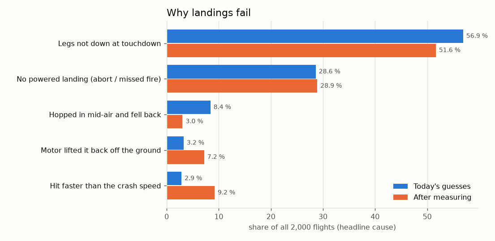
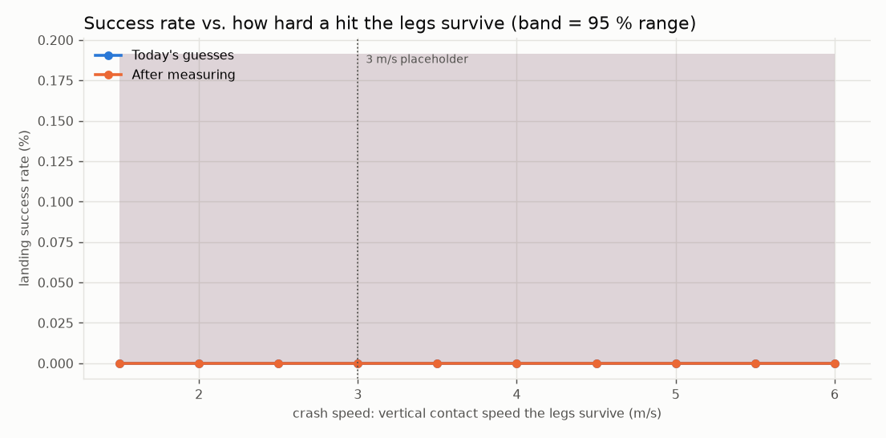

# RocketFC landing success rate (simulator)

*Generated 2026-10-24 15:39 by `tools/sim/landing_report.py` -- 813 s, 8800 flights.*

## The answer

Success = a powered landing that ends **upright and intact**: the F15 lit, nothing aborted, no hop, legs down at touchdown, contact under 3.0 m/s, and still standing 2 s after burnout.

| Scenario | Landing success rate (2,000 flights, 95 % range) |
|---|---|
| **Today's guesses** (mass +-5 %, e-match delay +-15 %, wind up to 4 m/s) | most likely **0.0 %** (0 of 2000), very likely between 0.0 % and 0.2 % |
| **After measuring** (mass +-1 %, delay +-5 %) | most likely **0.0 %** (0 of 2000), very likely between 0.0 % and 0.2 % |

The range is how sure the simulator is *of its own answer* (sampling): with 2,000 flights the true rate of this simulated rocket is very likely inside it. It does **not** cover the simulator being wrong about the real rocket -- the sensitivity table below shows how much the guessed numbers move it.

## Why landings fail

Headline cause = the first thing that went wrong, in time order. Count of all 2000 flights:

| Cause | Today | After measuring |
|---|---|---|
| No powered landing (abort / missed fire) | 572 (28.6 %) | 578 (28.9 %) |
| Hopped in mid-air and fell back | 168 (8.4 %) | 61 (3.0 %) |
| Legs not down at touchdown | 1138 (56.9 %) | 1033 (51.6 %) |
| Hit faster than the crash speed | 57 (2.9 %) | 184 (9.2 %) |
| Motor lifted it back off the ground | 65 (3.2 %) | 144 (7.2 %) |

Among flights that made a powered landing (1428 today, 1422 after measuring), how often each problem happened at all (a flight can have several):

| Problem | Today | After measuring |
|---|---|---|
| Hopped in mid-air and fell back | 11.8 % | 4.3 % |
| Legs not down at touchdown | 79.7 % | 72.6 % |
| Hit faster than the crash speed | 95.4 % | 89.9 % |
| Motor lifted it back off the ground | 88.2 % | 95.7 % |
| Tipped over | 99.6 % | 99.8 % |
| Blown over after standing | 0.0 % | 0.0 % |

Contact speeds of the powered landings -- vertical: median 14.8 / p90 26.3 m/s today, 15.6 / 25.1 after measuring; **sideways: median 1.4 / p90 1.9 m/s today**, 1.4 / 1.9 after measuring. The legs tip over at roughly 0.9 m/s sideways (between two legs) to 1.3 m/s (toward a leg) with the estimated geometry.

What pushed the 1423 falls over hardest (today; biggest cause vs. its own limit at contact):

| Push | Falls |
|---|---|
| thrust | 786 (55.2 %) |
| sideways | 637 (44.8 %) |

If a mid-air hop that still ends upright counted as success, the rates would be 0.0 % today and 0.0 % after measuring.

## How hard a hit can the legs take?

Crash speed is a [MEASURE] placeholder (3 m/s, about a 46 cm drop). Same flights, judged again at each limit:

| Crash speed | Today | After measuring |
|---|---|---|
| 1.5 m/s (drop from 11 cm) | 0.0 % [0.0 %-0.2 %] | 0.0 % [0.0 %-0.2 %] |
| 2.0 m/s (drop from 20 cm) | 0.0 % [0.0 %-0.2 %] | 0.0 % [0.0 %-0.2 %] |
| 2.5 m/s (drop from 32 cm) | 0.0 % [0.0 %-0.2 %] | 0.0 % [0.0 %-0.2 %] |
| 3.0 m/s (drop from 46 cm) | 0.0 % [0.0 %-0.2 %] | 0.0 % [0.0 %-0.2 %] |
| 3.5 m/s (drop from 62 cm) | 0.0 % [0.0 %-0.2 %] | 0.0 % [0.0 %-0.2 %] |
| 4.0 m/s (drop from 82 cm) | 0.0 % [0.0 %-0.2 %] | 0.0 % [0.0 %-0.2 %] |
| 4.5 m/s (drop from 103 cm) | 0.0 % [0.0 %-0.2 %] | 0.0 % [0.0 %-0.2 %] |
| 5.0 m/s (drop from 127 cm) | 0.0 % [0.0 %-0.2 %] | 0.0 % [0.0 %-0.2 %] |
| 5.5 m/s (drop from 154 cm) | 0.0 % [0.0 %-0.2 %] | 0.0 % [0.0 %-0.2 %] |
| 6.0 m/s (drop from 183 cm) | 0.0 % [0.0 %-0.2 %] | 0.0 % [0.0 %-0.2 %] |

## Sensitivity to the guessed numbers

Today's guesses, 600 flights (seeds 101-103), one change at a time vs. the same 600 flights with the defaults (foot radius 0.25 m, CG 0.60 m, friction 0.6, band burn 1.5 s):

| Change | Success rate [95 % range] | Legs not down | Tipped over |
|---|---|---|---|
| defaults | 0.0 % [0.0 %-0.6 %] | 81.4 % | 99.5 % |
| foot radius 0.15 m | 0.0 % [0.0 %-0.6 %] | 81.4 % | 99.8 % |
| foot radius 0.35 m | 0.0 % [0.0 %-0.6 %] | 81.4 % | 99.1 % |
| CG height 0.50 m | 0.0 % [0.0 %-0.6 %] | 81.7 % | 99.8 % |
| CG height 0.70 m | 0.0 % [0.0 %-0.6 %] | 81.0 % | 100.0 % |
| grass friction 0.4 | 0.0 % [0.0 %-0.6 %] | 81.4 % | 100.0 % |
| grass friction 0.8 | 0.0 % [0.0 %-0.6 %] | 81.4 % | 99.8 % |
| band burn 1.0 s (not 1.5) | 0.0 % [0.0 %-0.6 %] | 63.8 % | 98.9 % |
| band burn 0.5 s (not 1.5) | 0.0 % [0.0 %-0.6 %] | 56.0 % | 98.9 % |

## What the simulator does and doesn't know

- The legs are rigid and never break in the physics; "crash" is the speed rule above.
- Leg geometry, CG height, grass stiffness/friction and the band-burn time are estimates tagged [MEASURE]/[ESTIMATE] in `tools/sim/vehicle.py`.
- The TVC keeps flying after touchdown exactly as the firmware does; the F15 keeps burning (it can't be shut off), so if it is still pushing harder than the weight at contact, it lifts the rocket back off.
- Field slope is random 0-3 deg per flight; wind is steady (no gusts).
- Nothing in the flight firmware was changed.

## Watch it in 3D

Just the landing, same physics (run from the RocketFC folder):

- Lands upright: `python tools/sim/flight3d.py --drop -1` (1 m/s straight down)
- Falls over: `python tools/sim/flight3d.py --drop -1,1.5` (1 m/s down, 1.5 m/s
  sideways -- milder than a typical simulated landing, whose median is 2.9 m/s sideways)

A full Monte Carlo flight for each verdict:

- Legs not down at touchdown: `python tools/sim/flight3d.py --sim 101:0` -- Legs not down at touchdown (0% swung)
- Hit faster than the crash speed: `python tools/sim/flight3d.py --sim 101:1` -- Legs broken: hit at 3.5 m/s > 3.0 m/s limit
- Hopped in mid-air and fell back: `python tools/sim/flight3d.py --sim 101:3` -- Hopped: stopped 0.7 m up, climbed to 1.6 m and fell back
- No powered landing (abort / missed fire): `python tools/sim/flight3d.py --sim 101:4` -- No powered landing: aborted (tilt in DESCENT)
- Motor lifted it back off the ground: `python tools/sim/flight3d.py --sim 101:15` -- Motor lifted it back off after touchdown (3.38 m up)
