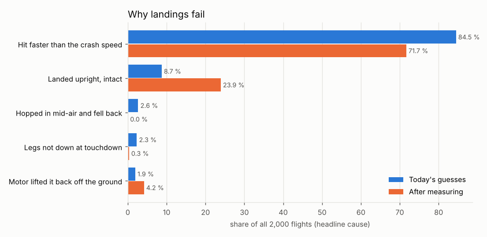
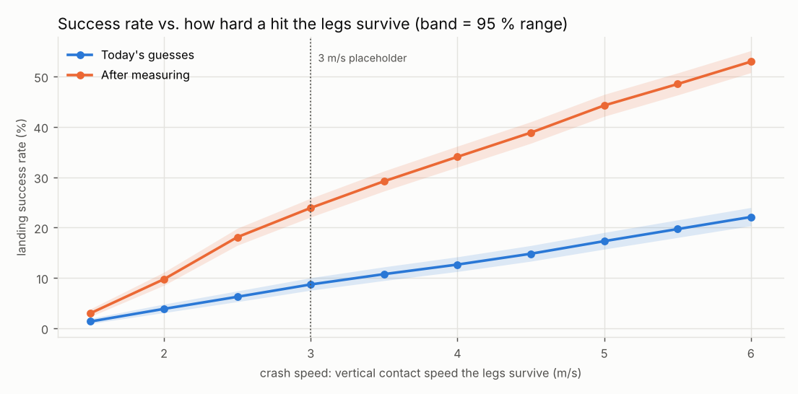

# RocketFC landing success rate (simulator)

*Generated 2026-10-25 08:39 by `tools/sim/landing_report.py` -- 723 s, 7600 flights.*

## The answer

Success = a powered landing that ends **upright and intact**: the F15 lit, nothing aborted, no hop, legs down at touchdown, contact under 3.0 m/s, and still standing 2 s after burnout.

| Scenario | Landing success rate (2,000 flights, 95 % range) |
|---|---|
| **Today's guesses** (mass +-5 %, e-match delay +-15 %, wind up to 4 m/s) | most likely **8.7 %** (174 of 2000), very likely between 7.5 % and 10.0 % |
| **After measuring** (mass +-1 %, delay +-5 %) | most likely **23.9 %** (478 of 2000), very likely between 22.1 % and 25.8 % |

The range is how sure the simulator is *of its own answer* (sampling): with 2,000 flights the true rate of this simulated rocket is very likely inside it. It does **not** cover the simulator being wrong about the real rocket -- the sensitivity table below shows how much the guessed numbers move it.

## Why landings fail

Headline cause = the first thing that went wrong, in time order. Count of all 2000 flights:

| Cause | Today | After measuring |
|---|---|---|
| Landed upright, intact | 174 (8.7 %) | 478 (23.9 %) |
| Hopped in mid-air and fell back | 53 (2.6 %) | 0 (0.0 %) |
| Legs not down at touchdown | 46 (2.3 %) | 6 (0.3 %) |
| Hit faster than the crash speed | 1689 (84.5 %) | 1433 (71.7 %) |
| Motor lifted it back off the ground | 38 (1.9 %) | 83 (4.2 %) |

Among flights that made a powered landing (2000 today, 2000 after measuring), how often each problem happened at all (a flight can have several):

| Problem | Today | After measuring |
|---|---|---|
| Hopped in mid-air and fell back | 2.6 % | 0.0 % |
| Legs not down at touchdown | 2.3 % | 0.3 % |
| Hit faster than the crash speed | 89.4 % | 72.0 % |
| Motor lifted it back off the ground | 46.5 % | 40.7 % |
| Tipped over | 42.4 % | 18.1 % |
| Blown over after standing | 0.0 % | 0.0 % |

Contact speeds of the powered landings -- vertical: median 6.5 / p90 10.1 m/s today, 3.9 / 5.9 after measuring; **sideways: median 0.4 / p90 0.7 m/s today**, 0.5 / 0.7 after measuring. The legs tip over at roughly 2.7 m/s sideways (between two legs) to 3.8 m/s (toward a leg) with foot radius 0.71 m and CG height 0.60 m.

What pushed the 848 falls over hardest (today; biggest cause vs. its own limit at contact):

| Push | Falls |
|---|---|
| thrust | 707 (83.4 %) |
| sideways | 107 (12.6 %) |
| tilt | 25 (2.9 %) |
| wind | 8 (0.9 %) |
| slope | 1 (0.1 %) |

If a mid-air hop that still ends upright counted as success, the rates would be 8.7 % today and 23.9 % after measuring.

## How hard a hit can the legs take?

Crash speed is a [MEASURE] placeholder (3 m/s, about a 46 cm drop). Same flights, judged again at each limit:

| Crash speed | Today | After measuring |
|---|---|---|
| 1.5 m/s (drop from 11 cm) | 1.4 % [0.9 %-2.0 %] | 3.0 % [2.3 %-3.8 %] |
| 2.0 m/s (drop from 20 cm) | 3.9 % [3.1 %-4.8 %] | 9.8 % [8.5 %-11.1 %] |
| 2.5 m/s (drop from 32 cm) | 6.2 % [5.3 %-7.4 %] | 18.1 % [16.5 %-19.8 %] |
| 3.0 m/s (drop from 46 cm) | 8.7 % [7.5 %-10.0 %] | 23.9 % [22.1 %-25.8 %] |
| 3.5 m/s (drop from 62 cm) | 10.8 % [9.5 %-12.2 %] | 29.2 % [27.2 %-31.2 %] |
| 4.0 m/s (drop from 82 cm) | 12.7 % [11.3 %-14.2 %] | 34.1 % [32.0 %-36.2 %] |
| 4.5 m/s (drop from 103 cm) | 14.8 % [13.3 %-16.4 %] | 38.9 % [36.7 %-41.0 %] |
| 5.0 m/s (drop from 127 cm) | 17.3 % [15.7 %-19.0 %] | 44.2 % [42.1 %-46.4 %] |
| 5.5 m/s (drop from 154 cm) | 19.7 % [18.0 %-21.5 %] | 48.5 % [46.3 %-50.7 %] |
| 6.0 m/s (drop from 183 cm) | 22.1 % [20.3 %-24.0 %] | 52.9 % [50.8 %-55.1 %] |

## Sensitivity to the guessed numbers

Today's guesses, 600 flights (seeds 101-103), one change at a time vs. the same 600 flights with the defaults (foot radius 0.71 m, CG 0.60 m, friction 0.6, band burn 1.5 s):

| Change | Success rate [95 % range] | Legs not down | Tipped over |
|---|---|---|---|
| defaults | 10.0 % [7.8 %-12.7 %] | 2.2 % | 43.0 % |
| CG height 0.50 m | 9.8 % [7.7 %-12.5 %] | 2.7 % | 27.7 % |
| CG height 0.70 m | 9.8 % [7.7 %-12.5 %] | 2.0 % | 52.7 % |
| grass friction 0.4 | 10.0 % [7.8 %-12.7 %] | 2.2 % | 16.0 % |
| grass friction 0.8 | 9.8 % [7.7 %-12.5 %] | 2.2 % | 48.0 % |
| band burn 1.0 s (not 1.5) | 10.0 % [7.8 %-12.7 %] | 0.0 % | 43.0 % |
| band burn 0.5 s (not 1.5) | 10.0 % [7.8 %-12.7 %] | 0.0 % | 43.0 % |

## What the simulator does and doesn't know

- The legs are rigid and never break in the physics; "crash" is the speed rule above.
- Leg geometry, CG height, grass stiffness/friction and the band-burn time are estimates tagged [MEASURE]/[ESTIMATE] in `tools/sim/vehicle.py`.
- The TVC keeps flying after touchdown exactly as the firmware does; the F15 keeps burning (it can't be shut off), so if it is still pushing harder than the weight at contact, it lifts the rocket back off.
- Field slope is random 0-3 deg per flight; wind is steady (no gusts).
- Nothing in the flight firmware was changed.

## Watch it in 3D

Just the landing, same physics (run from the RocketFC folder):

- Lands upright: `python tools/sim/flight3d.py --drop -1` (1 m/s straight down)
- Falls over: `python tools/sim/flight3d.py --drop -1,1.5` (1 m/s down, 1.5 m/s
  sideways -- milder than a typical simulated landing, whose median is 2.9 m/s sideways)

A full Monte Carlo flight for each verdict:

- Hit faster than the crash speed: `python tools/sim/flight3d.py --sim 101:0` -- Legs broken: hit at 7.2 m/s > 3.0 m/s limit
- Landed upright, intact: `python tools/sim/flight3d.py --sim 101:1` -- LANDED: upright, 3.0 m/s down, 0.3 m/s sideways
- Hopped in mid-air and fell back: `python tools/sim/flight3d.py --sim 101:9` -- Hopped: stopped 8.7 m up, climbed to 8.7 m and fell back
- Legs not down at touchdown: `python tools/sim/flight3d.py --sim 101:21` -- Legs not down at touchdown (97% swung)
- Motor lifted it back off the ground: `python tools/sim/flight3d.py --sim 101:38` -- Motor lifted it back off after touchdown (0.48 m up)
