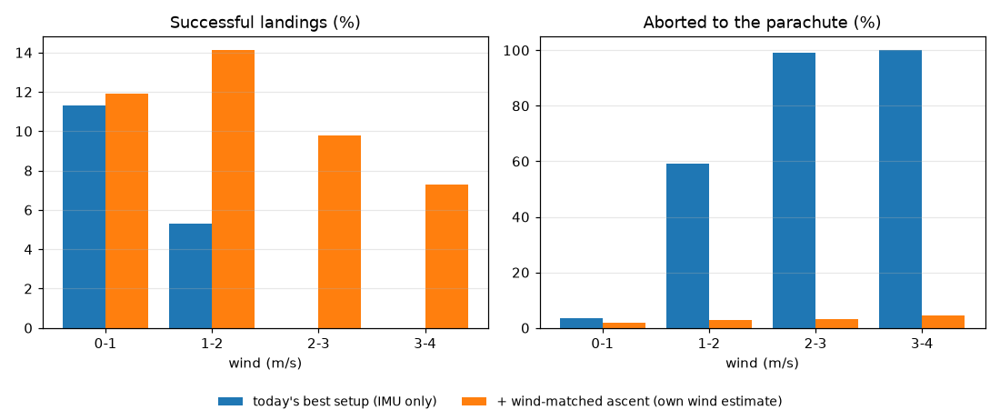

# New software-only ideas for landing success (simulator study)

*2026-10-19/20. Everything ran in scratch copies. **RocketFC was not changed**: `git status` is clean.
All numbers come from the closed-loop simulator. They assume:*
- *the ~10 % stronger ascent motor from the earlier study (apogee ~65 m);*
- *the fire point 1 m higher (`BURN_TABLE_MARGIN_M = 1.0`);*
- *the drift-cancelling loop (S3) and the D2 tilt rule;*
- *IMU only, no GPS.*

## The answer in five lines
1. **The best new idea is a wind-matched ascent.** During the boost the rocket leans a few degrees so that it
   reaches burnout drifting at the wind's speed, then stands upright for the last 0.6 s. It gets the wind
   from its own accelerometer.
2. **Holdout result, after measuring** (fresh seeds 501–510, 2,000 flights per row, run once): success
   **4.0 % → 10.8 %**, aborts **66 % → 3 %**. Paired: 156 landings rescued, 22 lost, p < 0.0001.
3. **Holdout result with today's guesses:** 1.2 % → 3.4 % (46 rescued vs 4 lost), so measuring mass and
   e-match delay is still essential.
4. **It needs the gimbal's zero to be known to about ±0.2°**, because a sideways thrust offset looks like
   wind to the estimate. At ±0.5° the gain is lost.
5. **Two simulator flaws were found along the way.** They change earlier conclusions; see below. Fixing them
   in `tools/sim` needs your OK.

## 1. Two simulator flaws
**a) The rocket is not held on the pad.** The plant lets the fin-less rocket rotate freely before launch.
- In wind it tips over (up to ~26° at 4 m/s before ignition).
- The pad gyro calibration averages that slow rotation in as gyro bias, so the attitude estimate drifts
  0.1–0.5 °/s and is 2–7° wrong by landing.
- This made almost every flight above 2 m/s of wind abort, and it is why GPS looked necessary.
- With the rocket held until ignition (switch `pad_hold`), the IMU alone keeps 98–99 % of landings under the
  sideways tip limit.
- **GPS no longer helps:** paired 5 rescued vs 5 lost on its own, and 15 vs 14 on top of the wind-matched
  ascent.

**b) The airframe's sideways air force only turned the rocket and never pushed it.** `plant.py` used the
normal force for torque only.
- With it also applied as a force (switch `normal_force_translates`), the baseline success is 3.8 % instead
  of 1.7 %.
- The accelerometer can then feel the crosswind, which the wind estimate relies on.

Both switches are off by default in the patch, so all earlier results reproduce exactly.

## 2. What actually limits success (with the flaws fixed)
- **Coast tip-over: 66–68 % of flights abort.** After burnout the rocket coasts up with no thrust, so the TVC
  can't steer.
  - Any air flowing across the fin-less body makes it swing over, past 30°, about 1 s before apogee.
  - At burnout the rocket is upright but the wind hits it side-on, so this happens to every flight above
    ~2 m/s of wind.
- **Vertical timing: most of the remaining failures.**
  - The e-match delay spread (±25 ms after measuring) is wider than the ~±10 ms window for a soft finish.
  - The result is hard hits, hops and lift-offs.
  - Knowing the delay exactly, or the drag exactly, would only be worth ~+3 points (13 % vs 10 %, not
    significant on 600 flights). The F15's fixed burn is the deeper limit.

## 3. The ideas, tested

| # | Idea (software only) | Result in the sim | Verdict |
|---|---|---|---|
| 1 | **Wind-matched ascent with an in-flight wind estimate** | Holdout 4.0 → 10.8 %, aborts 66 → 3 % (156 vs 22) | **Best new lever** |
| 1a | ...with the true wind (upper bound) | 3.8 → 10.7 % (dev) | The estimate gets nearly all of it |
| 1b | ...wind estimate 25 % low / 25 % high / direction 30° off (true wind scaled) | 11.0 % / 7.2 % / 4.2 % | Reading low is safe, reading high costs a lot, direction must be within ~15° |
| 2 | Ascent drift cancelling with no wind estimate (target = standing still) | 1.7 → 2.8 % (dev, not significant), calm air only | Small |
| 3 | Shrink the wind estimate toward 0 while it is uncertain (prior 1 m/s) | Normal noise 10.5 %; 2× vibration noise 7.7 % vs 3.0 % (33 vs 5) | Keep it: it makes 1 robust to vibration |
| 4 | Also solve for a constant thrust offset in flight | Robust to a ±0.5° gimbal error (9.2 %), but ~24 % aborts and only 7.5–9 % nominal | Not worth it: calibrate the gimbal zero instead |
| 5 | Re-tune the fire margin for the new ascent | 0 m 5.0 %, +0.5 m 7.7 %, **+1 m 10.2 %**, +1.5 m 9.8 %, +2 m 10.5 % | Keep +1 m |
| 6 | Know the e-match delay / drag exactly (upper bound for delay compensation from battery volts and temperature, or for drag measured in the fall) | 10.2 → 13.0 % either way (not significant) | Small; the real fix is measuring |
| 7 | Same ideas at today's apogee (no stronger ascent motor) | 0 % before and after | The energy match still needs the bigger motor |

**Robustness of idea 1 + 3** (600 development flights each, paired against the same case without it):

| Stress case | Without | With | Rescued / lost |
|---|---|---|---|
| Nominal | 3.8 % | 10.5 % | 46 / 6 |
| Normal-force coefficient ±30 % | 3.3 % | 10.2 % | 46 / 5 |
| 2× accelerometer noise in the burn | 3.0 % | 7.7 % | 33 / 5 |
| Gimbal zero error ±0.2° | 3.7 % | 9.2 % | 40 / 7 |
| Gimbal zero error ±0.5° | 3.3 % | 4.2 % | 14 / 9 (no gain) |
| All three, ±0.2° gimbal | 3.0 % | 5.5 % | 27 / 12 |
| All three, ±0.5° gimbal | 3.3 % | 3.8 % | 19 / 16 (no gain) |

## 4. How the wind-matched ascent works
1. **Estimate the wind during the boost** (`windEstStep` in `flight_core.h`, switch `WIND_EST`).
   - The accelerometer's sideways reading, minus the gimbal's share of the thrust, is the air force on the
     body.
   - Divide by `0.5·ρ·|V|·CNα·A` to get the air's sideways speed past the rocket. Add the dead-reckoned
     rocket velocity to get the wind.
   - Each sample is weighted by how much force 1 m/s of crosswind makes at that airspeed.
   - The estimate is pulled toward 0 while it is uncertain (`WIND_EST_PRIOR_MPS = 1`) and scaled by 0.8
     (`WIND_EST_SCALE`), because reading low is the safe direction.
2. **Steer the boost** (`BOOST_DRIFT_GAIN = 1`, `WIND_MATCH`).
   - From 0.3 s into the boost, lean the TVC target up to 5° to push the rocket's sideways speed toward the
     wind estimate.
   - Stand upright for the last 0.6 s before the expected burnout.
3. **Effect:** the rocket coasts with the air instead of across it. Tilt at apogee drops from ~25° to ~8°,
   and tilt at fire from ~17° to ~9°. The landing burn's existing S3 loop cancels the drift.
4. **Side effect:** it lands further downwind (it drifts with the wind, up to ~50 m in 4 m/s).

## 5. What to do before trusting it
- **Calibrate the gimbal zero to ±0.2°.** Use servo trim plus the bench/gimbal direction test, and check for
  motor thrust misalignment on the ThrustStand.
- **Log the IMU during a static F15 burn** to learn the real vibration level. The sim assumes 0.8 m/s²
  per sample; at 2× it still works with idea 3, at higher levels unknown. The BMI088's own filter setting
  can lower it.
- **Fly `CHUTE_TEST` first with the estimator in log-only mode.**
  - Compare its wind direction and speed with where the chute drifts.
  - The same log lets you fit the airframe's real normal-force coefficient (here an estimate, `CNα·A`
    = 0.00884 m²).
- **The sim's limits:**
  - steady wind, no gusts or wind shear (shear makes the boost estimate read low, the safe direction);
  - IMU at the CG;
  - no motor-to-motor thrust variation.

## Files
- `patches/ideas_full.patch`: RocketFC HEAD → every candidate so far (S3, D2, GPS, ATH, solver, plus the new
  `BOOST_DRIFT_*`, `WIND_MATCH`, `WIND_EST*` and the sim switches `pad_hold`, `normal_force_translates`,
  `wind_oracle*`, `gimbal_offset_*`).
  - Every switch is off by default. It reproduces HEAD bit-for-bit (24-flight check).
  - It passes the replay, bridge and landing-outcome tests.
  - Apply with `patch -p1 --binary`.
- Study values for idea 1: `BOOST_DRIFT_GAIN 1.0f`, `WIND_MATCH true`, `WIND_EST true`,
  `WIND_EST_PRIOR_MPS 1.0f` (with `DRIFT_GAIN 2.0f`, `TILT_PREDICT_INTERLOCK true`,
  `BURN_TABLE_MARGIN_M 1.0f`). Sim: `pad_hold=true normal_force_translates=true`.
- `patches/ideas_scripts/`: how it was run (`ideas.py` driver, `followups.py`, `robust*.py`, `shrink.py`,
  `final_checks.py`, `holdout_ideas.py`). The thrust-offset solver (idea 4) is in `patch_ideas7.py`, not in
  the patch.
