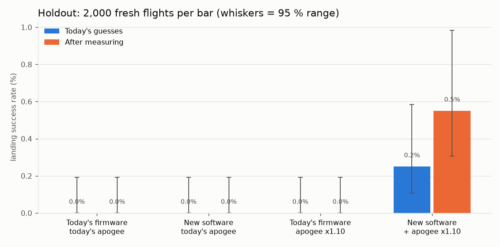
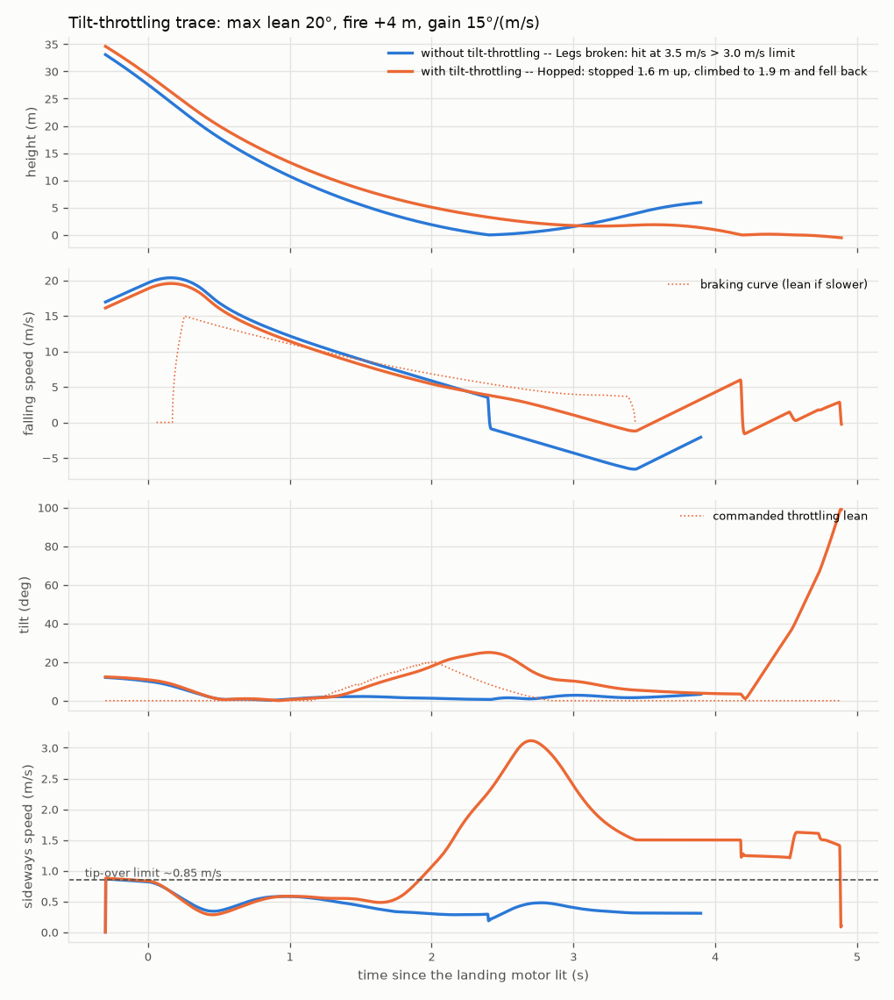

# Can software raise RocketFC's landing success rate? (simulator study)

> **Update 2026-10-20:** these results came from a simulator with two flaws, both now fixed in `tools/sim`:
> - the rocket could tip over on the pad in wind before launch, which corrupted the gyro calibration;
> - the sideways air force turned the rocket but never pushed it.
>
> Wind-driven aborts and the GPS benefit were overstated. See `software-landing-study/new-ideas-2026-10-19.md` for re-run numbers.

*2026-10-17. Everything ran in scratch copies. **RocketFC was not changed**: source hashes were checked
before and after. Leg-release timing was left alone, by your decision.*

## The answer in four lines
1. **Software alone: no.** No firmware change tested, alone or combined, lands a single flight at today's
   apogee: 0 of 2,000 in the holdout, before and after measuring.
2. **Software plus a slightly higher apogee: yes, the first successes.**
   - The setup: the drift-cancelling loop (S3), the D2 tilt rule (S4a), and a ~10 % stronger ascent motor
     (apogee ~48 → ~65 m).
   - Holdout results:
     - 0.25 % today (5 of 2,000; 95 % range 0.1–0.6 %);
     - 0.55 % after measuring mass and e-match delay (11 of 2,000; 0.3–1.0 %);
     - 2.2 % in calm wind after measuring.
3. **Neither half works alone.** The software at today's apogee gives 0 %, and the higher apogee with
   today's firmware gives 0 %.
4. **Every success was a calm-wind flight (under 0.5 m/s) that fired at 17.5–18.8 m/s.** The best touched
   down at **0.3 m/s**: `py watch.py`.

## Two things the study found
**1. The F15 can only finish a landing softly from one fall speed.** At 0.95 kg the motor has energy to
spare unless the rocket is falling about **17–21 m/s** when it fires. Any slower and it stops the rocket,
then pushes it back up off the ground. The fall from there is the "motor lifted it back off" failure.

A burn table that counts lift-offs (`patches/all_candidates.patch`, `tools/burn_table_liftoff.py`) picks
the *same* fire heights as today's table, so timing can't fix this. The best possible outcome depends on
the fall speed at fire:

| Fall speed at fire | Best possible worst impact |
|---|---|
| 12 m/s | 8.4 m/s |
| 15 m/s (today's nominal) | 4.4 m/s |
| **18 m/s** | **0.8 m/s** |
| 22 m/s | 2.9 m/s |

That means a **higher** apogee (~60–65 m) is needed, not the lower one suggested earlier. The earlier
suggestion didn't account for lift-offs.

**2. The drift-cancelling loop is the software change that matters.**
- What it does: the firmware integrates the world-frame accelerometer from launch to estimate sideways
  velocity. During the landing burn it leans the TVC target up to 5° against that velocity.
- Effect: landings under the ~0.85 m/s tip limit go from 0 % to ~24 % of powered landings.
- Without it, nothing succeeds at any apogee.

## Each candidate on the development flights (600 flights, seeds 101–103, today's guesses)
| Candidate | Success [95 %] | Calm-wind success | Powered | Sideways median (m/s) | Sideways < tip limit | Legs late | Lifted off |
|---|---|---|---|---|---|---|---|
| Today (baseline) | 0.0 % [0.0-0.6] | 0.0 % | 38 % | 2.75 | 0 % | 65 % | 80 % |
| S2a fire margin -3 m | 0.0 % [0.0-0.6] | 0.0 % | 38 % | 2.48 | 0 % | 90 % | 97 % |
| S2a fire margin +3 m | 0.0 % [0.0-0.6] | 0.0 % | 38 % | 2.96 | 0 % | 37 % | 52 % |
| S3 drift loop K=1 | 0.0 % [0.0-0.6] | 0.0 % | 38 % | 2.25 | 20 % | 65 % | 80 % |
| S3 drift loop K=2 | 0.0 % [0.0-0.6] | 0.0 % | 38 % | 2.34 | 27 % | 65 % | 80 % |
| S4a D2 interlock | 0.0 % [0.0-0.6] | 0.0 % | 41 % | 3.03 | 0 % | 60 % | 76 % |
| S4b coast grace | 0.0 % [0.0-0.6] | 0.0 % | 38 % | 2.75 | 0 % | 65 % | 80 % |
| S5 landing ki = 0 | 0.0 % [0.0-0.6] | 0.0 % | 38 % | 2.43 | 6 % | 63 % | 80 % |
| S6 centre gimbal at impact | 0.0 % [0.0-0.6] | 0.0 % | 38 % | 2.75 | 0 % | 65 % | 80 % |
| Combination at today's apogee | 0.0 % [0.0-0.6] | 0.0 % | 41 % | 2.76 | 25 % | 59 % | 75 % |
| Today's firmware, apogee x1.10 | 0.0 % [0.0-0.6] | 0.0 % | 30 % | 2.51 | 0 % | 73 % | 95 % |
| Combination, apogee x1.10 | 0.5 % [0.2-1.5] | 2.1 % | 31 % | 2.38 | 27 % | 34 % | 76 % |
| &nbsp;&nbsp;...without S3 drift loop | 0.0 % [0.0-0.6] | 0.0 % | 31 % | 2.46 | 2 % | 33 % | 75 % |
| &nbsp;&nbsp;...without S4a D2 | 0.3 % [0.1-1.2] | 1.4 % | 30 % | 2.03 | 29 % | 73 % | 95 % |
| &nbsp;&nbsp;...without S5 / S6 (= final) | 0.5 % [0.2-1.5] | 2.1 % | 31 % | 2.43 | 26 % | 35 % | 76 % |

- **S2a (fire earlier or later)** only trades hops against lift-offs. **S2b** (the lift-off-aware table)
  gives the same fire heights as today's table, so it wasn't flown.
- **S4b (no tilt abort while coasting)** doesn't help. Every coast abort just becomes a descent abort: the
  fin-less airframe doesn't swing back tail-first in time.
- **S5 and S6** make no difference to the result, so they were dropped from the final set.
- The drift gain is not critical (K = 1 and K = 2 give the same result). K = 4 is slightly worse.

## Holdout (seeds 201–210, 2,000 fresh flights per row, run once)
| Spreads | Setup | Success [95 %] | Calm wind [95 %] | Aborts | Sideways < tip limit |
|---|---|---|---|---|---|
| today | Today's firmware, today's apogee | 0.0 % [0.0-0.2] | 0.0 % [0.0-0.8] | 59 % | 0 % |
| today | New software, today's apogee | 0.0 % [0.0-0.2] | 0.0 % [0.0-0.8] | 56 % | 24 % |
| today | Today's firmware, apogee x1.10 | 0.0 % [0.0-0.2] | 0.0 % [0.0-0.8] | 67 % | 0 % |
| today | **New software + apogee x1.10** | **0.25 % [0.1-0.6]** | **1.0 % [0.4-2.3]** | 67 % | 24 % |
| measured | Today's firmware, today's apogee | 0.0 % [0.0-0.2] | 0.0 % [0.0-0.8] | 59 % | 0 % |
| measured | New software, today's apogee | 0.0 % [0.0-0.2] | 0.0 % [0.0-0.8] | 55 % | 23 % |
| measured | Today's firmware, apogee x1.10 | 0.0 % [0.0-0.2] | 0.0 % [0.0-0.8] | 65 % | 0 % |
| measured | **New software + apogee x1.10** | **0.55 % [0.3-1.0]** | **2.2 % [1.2-3.8]** | 65 % | 24 % |

**Pass bar (fixed before running):** the success range must exclude 0 %, with no rise in aborts or in
crashes above the crash speed.
- "New software + apogee x1.10" passes against today's firmware at the same apogee: aborts equal (67 %),
  crashes lower (92 % vs 95 %).
- "New software" alone fails: 0 %.
- The higher apogee does raise aborts (59 → 67 %): more time in the air means more wind-driven tilt.

## What would push it further (not tested here)
- **Calm-wind launches.** Every success had wind under 0.5 m/s. In calm wind, no flight aborted at all.
- **Legs.** "Legs not down" is still in 15–35 % of powered landings. Leg timing was off-limits, so this stays.
- **The F15/mass energy match.** Firing at 17–21 m/s is what makes a soft finish possible. A real
  ascent-motor choice would be needed: the "x1.10" here is a scaled F15 curve, standing in for a slightly
  bigger motor.

## Caveats
- The drift loop's accuracy depends on how well the real IMU and AHRS hold attitude through boost. The sim's
  sensors (noise and constant biases, no vibration) are probably kinder than a real F15 boost. **Bench it,
  and check it in a CHUTE_TEST log** (dead-reckoned sideways speed vs the drift you can see) before trusting it.
- The success rates are still tiny. This shows *what can work in the sim*, not a flight-ready landing.
- D2 relaxes your "never light beyond 15°" rule: it allows lighting at up to 25° if the rocket is
  predicted to be under 15° when thrust starts.

## Follow-up: GPS-aided drift loop (2026-10-18)
BPS.space and both open-source landing designs use GPS for sideways velocity (see
`..\landing-research-others.md`). So the drift loop was given a simulated u-blox M9/M10-class GPS:
- 10 Hz, 0.1 m/s noise, 0.1 s latency;
- each sample pulls the dead-reckoned sideways velocity part of the way toward the GPS
  (`GPS_VEL_GAIN`, off by default).

Same copy, same rules. With GPS switched off, the earlier results reproduce bit-for-bit.

**Development (600 flights, today's guesses, apogee x1.10):**

| Setup | Success | Calm wind | Sideways median | Under tip limit |
|---|---|---|---|---|
| S3 + D2 (IMU only) | 0.5 % | 2.1 % | 2.43 m/s | 25 % |
| + GPS, gain 0.1 | 0.7 % | 2.8 % | 0.88 m/s | 49 % |
| **+ GPS, gain 0.3** | **1.0 %** | **4.2 %** | **0.53 m/s** | **59 %** |
| + GPS, gain 0.6 | 1.0 % | 4.2 % | 0.46 m/s | 61 % |
| + GPS 0.3, noise 0.3 m/s, 0.2 s late | 0.7 % | 2.8 % | 0.56 m/s | 59 % |

**Holdout (seeds 201–210, 2,000 flights each, run once):**

| Spreads | Setup | Success [95 %] | Calm wind | vs. IMU only |
|---|---|---|---|---|
| today | S3 + D2 + GPS, today's apogee | 0.0 % [0.0-0.2] | 0.0 % | 0.0 % |
| today | **S3 + D2 + GPS, apogee x1.10** | **0.40 % [0.2-0.8]** (8) | 1.6 % | 0.25 % (5) |
| measured | **S3 + D2 + GPS, apogee x1.10** | **1.30 % [0.9-1.9]** (26) | **5.1 %** | 0.55 % (11) |

**Paired on the same flights:**
- After measuring: GPS rescues 18 landings and loses 3 (sign test p ≈ 0.002), so the gain is real.
- Today's guesses: 4 vs 1, the right direction but too few landings to call.

**What GPS changes:**
- **Sideways speed at touchdown is largely solved:** median 2.4 → 0.6 m/s, and about 92 % of calm-wind
  powered landings come in under the tip limit.
- **The remaining failures are vertical:** hard hits and lift-offs (75–92 % of powered landings). That is
  the energy/timing problem: the igniter-delay spread, and a fixed F15 burn with no throttle. GPS can't fix
  it, and at today's apogee it's still 0 %.

**Caveats:**
- Real GPS on a model rocket is harder than the sim's: BPS's Scout E tipped over because of a weak GPS
  signal.
- It needs an airborne dynamic model, an antenna with sky view (BPS's lesson: mount it high), and a lock
  before launch.
- The firmware blend ignores GPS latency. A real implementation should buffer the IMU estimate to the GPS
  timestamp.

**File:** `patches/final_S3_D2_GPS.patch`, with S3, D2 and the GPS blend all off by default. The firmware
part is `GPS_VEL_GAIN` plus `FlightCore::gpsVelocity()`. The sim part is the `rfc_gps_vel` bridge call and
the `gps_hz` / `gps_vel_sigma` / `gps_latency_s` settings. Apply with `patch -p1 --binary`, because these
files use Windows line endings. It passes the replay, bridge and landing-outcome tests. Study values:
`DRIFT_GAIN 2.0`, `TILT_PREDICT_INTERLOCK true`, `GPS_VEL_GAIN 0.3`.

## Follow-up: "artificial throttling" by tilting the rocket (2026-10-18), result: no gain
**What was tested.** This is the one software-only way to change the effective thrust after ignition:
- BPS flew a version in 2020, and Joshi's ISEF project designed one (97 % in his sim).
- During the burn, whenever the rocket falls slower than a braking curve (thrust to spare, so it would
  stop high and lift off or hop), the firmware leans it up to 15–25° off vertical. That loses
  1 − cos(lean) of the upward push.
- The lean direction circles so the sideways push cancels.
- The lean fades to zero a few metres up, so the rocket lands upright.
- It runs on top of the best setup (S3 drift loop + D2 + GPS). The fire point was optionally moved
  earlier to create spare thrust to shed.
- It's off by default, and with it off every earlier result reproduced bit-for-bit.

**Two fixes found during the trace check, before the grid:**
- The braking estimate is capped at the F15's ~14 N steady thrust, because the brief ~24 N ignition spike
  made it lean early for nothing.
- The lean is eased in and out at 60°/s. A lean switched on and off abruptly left a net sideways push.

**Development grid** (600 flights per row, seeds 101–103; 46 configurations in total):
- **Today's apogee: 0 % in all 18 configurations** (max lean 15/20/25°, fire 0/+2/+4 m higher, two gains).
  - Firing higher with tilt-throttling cut lift-offs (74 % → 39 %), but those flights hopped instead
    (26 % → 61 %).
  - Hard hits stayed ~92 %.
  - Sideways speed got worse (median 0.67 → up to 2.4 m/s).
- **Apogee x1.10: never better than without it** (best 1.0 %, the same as the baseline; +2 m was worse,
  0.7 %).
  - Varying the circle speed (1.0 / 1.5 / 2.5 s) and the straighten height (1.5 / 2 / 3 m) changed nothing.
  - Letting it lean down to 0.5 m cut mid-air hops (23 % → 4–8 %). But those flights then reached the ground
    with the motor still pushing and were lifted back off, and success fell to 2.2 % vs 2.8 %.
- **After measuring, the first apparent win was a false lead.** Tilt-throttling with the fire point 1 m
  higher scored 1.2 % → 2.8 %. But firing 1 m higher *without* tilt-throttling scored the same 2.8 %, with
  the same flights succeeding (0 rescued, 0 lost). The gain was the fire timing, not the tilting.

*Trace, today's apogee, firing 4 m higher, 20° max lean. It only finds the spare thrust 1.5–2.5 s into the
burn. The lean overshoots to ~25°, and the gimbal can't swing the rocket round fast enough, so sideways speed
reaches 3.1 m/s. It still stops 1.6 m up, hops, and falls over.*

**Holdout (fresh seeds 401–410, 2,000 flights each, run once, apogee x1.10):**

| Spreads | Setup | Success [95 %] | Calm wind | Paired vs. the line above |
|---|---|---|---|---|
| today | best setup, margin 0 | 0.85 % [0.5-1.4] | 3.4 % | — |
| today | + tilt-throttling | 0.85 % [0.5-1.4] | 3.4 % | rescued 0, lost 0 |
| measured | best setup, margin 0 | 0.75 % [0.5-1.2] | 3.0 % | — |
| measured | **best setup, fire 1 m higher** | **2.15 % [1.6-2.9]** | **8.3 %** | **rescued 43, lost 15 (p < 0.001)** |
| measured | fire 1 m higher + tilt-throttling | 2.15 % [1.6-2.9] | 8.3 % | rescued 0, lost 0 |

**Verdict: tilt-throttling fails the pre-registered bar.** It never rescued a single landing on the holdout.

**Why it can't work on this rocket:**
- The F15's steady ~14 N is about 1.6× the weight. Hovering until burnout would need a ~52° lean;
  20–25° only removes 6–9 % of the thrust.
- The rocket only learns it has spare thrust in the last seconds. That is exactly when it must
  straighten up to land, and the ±5° gimbal can't swing it round fast enough to cancel the sideways push.
- That matches BPS dropping its 2020 TVC-wiggle for exhaust paddles.

**Side finding that did hold up:** once mass and e-match delay are measured, firing **1 m higher**
(`BURN_TABLE_MARGIN_M = 1.0`, an existing RocketFC setting) more than doubles success: 0.75 % → 2.15 %, and
3.0 % → 8.3 % in calm wind.
- Paired: 43 rescued vs 15 lost, p < 0.001, on fresh seeds.
- It is a config change, not new code, but it only helps **after measuring**. With today's guesses it
  made no difference.
- It was found on the development flights, not pre-registered, so treat it as one confirmed holdout, not
  gospel.

**File:** `patches/final_S3_D2_GPS_ATH.patch` = S3 + D2 + GPS + tilt-throttling, every switch off by
default (`THR_TILT_MAX_DEG 0`). Apply with `patch -p1 --binary`. Kept for the record only; not
recommended.

## Files
- `patches/final_S3_D2.patch`: the two changes that matter, **both off by default** (`DRIFT_GAIN 0`,
  `TILT_PREDICT_INTERLOCK false`).
  - It applies cleanly to today's tree, and the replay tests pass.
  - Study values: `DRIFT_GAIN 2.0`, `TILT_PREDICT_INTERLOCK true`.
  - D2 comes with the 2026-10-12 solver framework. Its TABLE mode stays bit-identical to today, and this
    patch wires D2 into it.
- `patches/all_candidates.patch`: every candidate (S3, S4a, S4b, S6, S2b table), all off by default.
- `patches/study.py`, `holdout.py`, `patch_cand.py`: how the study was run.
- `example_success.json` / `example_failure.json` + `watch.py`: `py watch.py` or `py watch.py failure`
  replays them in the 3D view.
- `dev_table.md`, `hold_table.md`, `holdout.png`.
